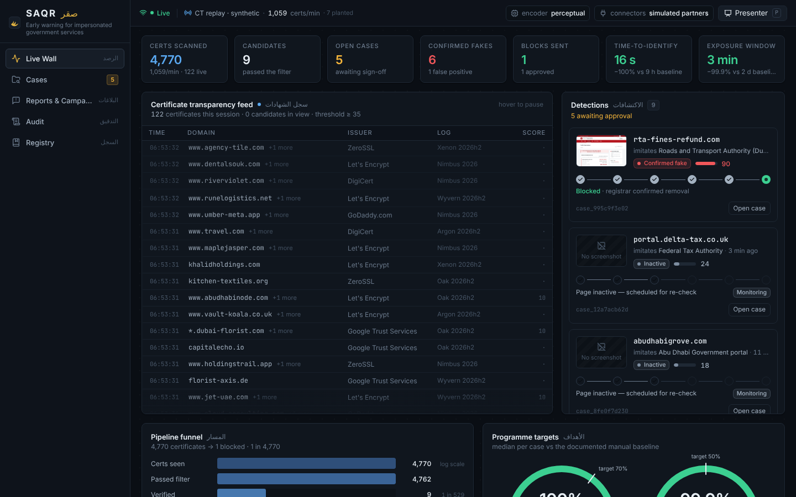
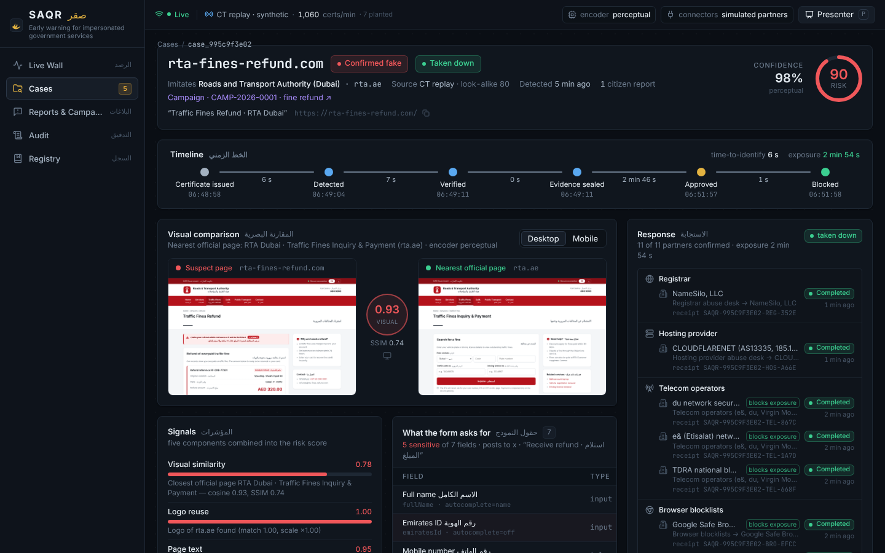
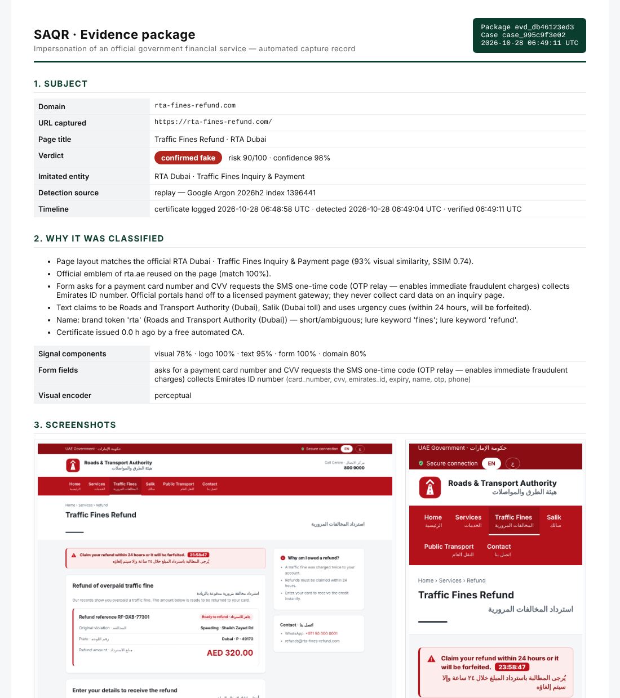

# SAQR · صقر — early warning and one-click takedown for impersonated government financial services

> hackathon.ae 2026 · Pioneers track · *Digital Trust & Cyber-Secure Nation* · Challenge: proactively detect, verify and
> respond to websites, messages and domains impersonating official government financial services — 70 % faster
> identification, 50 % shorter exposure — under identity, privacy, evidentiary and legal constraints.

Scammers build fake versions of government payment pages (fines, fees, refunds) and send the links by SMS or WhatsApp.
Today those pages are found after someone has lost money, and taking them down means contacting the registrar, the host
and the telecom operators one by one, so a fake stays online for days. **SAQR catches them while they are being set
up**: every HTTPS site needs a certificate, every certificate is published in public logs within minutes, and the fake
needs a convincing name. SAQR watches the logs live, verifies each look-alike in an isolated browser, seals a
court-ready evidence package automatically, and lets an analyst block the page everywhere with one click.

**S**ense · **A**ssess · **Q**ualify · **R**espond — the falcon (صقر) sees the prey long before it strikes.



## What it does

| Stage | What happens | Where |
|---|---|---|
| **Sense** | Tails Certificate Transparency logs directly (RFC 6962), ~150 certificates/s; a deterministic look-alike filter (allow-list, homograph skeleton, brand tokens, typo permutations, edit distance, lure keywords, government cues) keeps ~0.03 % as candidates — with a reason for every point. Forwarded SMS/WhatsApp, bank/telecom reports and threat feeds enter the same queue. | `saqr/sensing/` |
| **Assess** | Opens each candidate in a throw-away Chromium (desktop + mobile), compares the screenshot with a gallery of official pages (DINOv3/DINOv2 when installed, perceptual encoder otherwise), detects emblem reuse, reads what the form asks for (card number, CVV, expiry, OTP, Emirates ID, password), checks the text for entity claims (EN/AR) and urgency cues, and fuses it all into an explainable verdict and risk score. Unreachable or parked names are re-checked automatically. | `saqr/verification/` |
| **Qualify** | Builds the evidence package: screenshots, DOM, HAR, DNS, RDAP, certificate + the CT log entry, hosting/ASN and abuse contacts, IOCs (IBANs, wallets, numbers), SHA-256 per artefact, Merkle root, RFC 3161 time-stamp (or a labelled local signature), chain of custody, human-readable report, zip. | `saqr/evidence/` |
| **Respond** | One click by a named analyst fans out to registrar, hosting provider, telecom operators (via TDRA: URL block + SMS filter + RPZ), browser blocklists, banks/CBUAE, the issuing CA and aeCERT, with receipts and acknowledgements per channel. Messages and sites are grouped into campaigns. Safeguards in code: the allow-list is re-checked at dispatch, a human must approve, every step is in a hash-chained audit log. | `saqr/response/` |

The analyst dashboard (React) shows the live feed, the detection cards moving through the stages, each case with the
suspect page next to the official one, the evidence package, the one-click response panel, campaigns, the audit chain
and the protected registry — plus the time-to-identify and exposure gauges against the 70 % / 50 % targets.



## Quick start

```bash
git clone https://github.com/stevestrobert/saqr && cd saqr
make setup            # venv + pip install -e ".[dev]" + Chromium for Playwright
make demo             # http://localhost:8000  (offline: replayed certificate feed + scripted scam wave)
```

Other ways to run it:

```bash
saqr demo --live      # the same demo on top of the REAL global certificate logs (demo domains injected into the live feed)
saqr serve --source ctlogs          # production-style: tail Google Argon/Xenon logs, no scenario
saqr watch --seconds 60             # terminal only: live feed + matcher, no browser
saqr match rta-fines-refund.com xn--tx-refund-gov-w1k.com www.rta.ae
saqr verify https://example.com     # one-off verification of a URL
saqr evidence verify var/evidence/<case_id>/<package_id>   # recompute hashes, Merkle root, timestamp signature
docker compose up --build           # container with Chromium preinstalled; dashboard on :8000
```

Python 3.11+, Node 22 only if you rebuild the dashboard (`make frontend`; the compiled bundle is committed in
`frontend/dist`). Settings are environment variables prefixed `SAQR_` (see `.env.example`): certificate source
(`replay | ctlogs | certstream | hybrid`), visual encoder (`perceptual | dino`), TSA URLs, baselines, demo speed.

Press **`p`** in the dashboard for the Presenter drawer: start/stop/reset the scenario, fire any step immediately,
inject a domain into the feed. The full walk-through is in [`docs/demo-script.md`](docs/demo-script.md).

## The demo scenario

`demo/scenario.yaml` replays a "fine refund" scam wave against fixture sites served locally (`demo/sites/`; fictional
replicas with original artwork, served only on localhost):

1. `rta-fines-refund.com` gets a Let's Encrypt certificate → flagged in the ticker within seconds → verified as a clone of
   the RTA fines page collecting card number, CVV and OTP → evidence sealed → awaiting approval.
2. A citizen forwards the SMS lure → linked to the case; a campaign is opened.
3. `salik-recharge-ae.com`, `emiratespost-redelivery.shop` and their SMS variants follow (the two parcel texts cluster).
4. `finesse-payroll.com` is discarded by the cheap filter; `rta-ae-fitness.com` passes the filter and is **cleared** by
   verification (a gym) — nothing is blocked without a verdict and a human.
5. `dubaipolice-fines.online` is parked → monitored → the scammer activates it later → the scheduled re-check catches it.
6. `tаx-refund-gov.com` (Cyrillic а, IDN homograph) and a bank-reported `moi-uae-fines-pay.com` that never appeared in the
   logs show the other detection paths.
7. **Approve & block everywhere** → telecom and browser blocks acknowledged in seconds, registrar/host takedown follows;
   exposure measured from the certificate timestamp to the first confirmed block.

## Evidence package



Each package (`var/evidence/<case>/<package>/`, never overwritten) contains `manifest.json` with SHA-256 for every artefact and a Merkle root, a
time-stamp token over `sha256(manifest.json)` (RFC 3161 from a public TSA when reachable, otherwise an Ed25519 signature
by the node key — the package says which), `chain_of_custody.json`, `report.html` and `package.zip`. Anyone can
re-verify it offline with `saqr evidence verify <dir>` or with `sha256sum` and `openssl ts -verify`.

## Honest scope

* **What the certificate filter catches:** fakes that put the target's name (or a look-alike) in their own domain — the
  group that makes SMS links convincing, and where the time-to-identify gain comes from.
* **What it does not:** meaningless names (`xk7q2.shop`), wildcard certificates, free-hosting subdomains, hacked
  legitimate sites. Those reach SAQR reactively (forwarded messages, bank/telecom reports, feeds) and go through the
  same verification, evidence and one-click block — where most of the exposure gain comes from.
* **Encoder:** DINOv3 (`facebook/dinov3-vits16-pretrain-lvd1689m`, gated) with DINOv2 fallback via `pip install
  "saqr[ml]"` and `SAQR_VISUAL_ENCODER=dino`. The default perceptual encoder needs no ML dependencies and is what the
  demo runs on; on the fixture set clones score 0.92–0.94 and unrelated pages < 0.3.
* **Connectors** are simulated in this build (realistic payloads, simulated acknowledgements); live transports are a
  configuration seam. **Baselines** for the 70 % / 50 % comparison are documented assumptions
  ([`docs/metrics.md`](docs/metrics.md)), to be replaced by the organisers' historical data.
* **Privacy:** SAQR looks only at what scammers publish (certificates, public pages). Reporter numbers are masked and
  hashed, identifiers in forwarded texts are scrubbed before storage, no citizen browsing data is touched.
* **Access control:** the MVP has no authentication; the analyst identity on an approval is self-declared. A
  deployment sits behind the entity's SSO (UAE PASS for analysts) and a reverse proxy; the audit chain records whatever
  identity the proxy asserts.

## Repository

```
saqr/            Python package: sensing/ verification/ evidence/ response/ api/ demo/ pipeline.py cli.py
saqr/data/       protected registry (official domains, brands, lure vocabulary), confusables, lexicon, CT log list
frontend/        React + TypeScript dashboard (Vite, Tailwind); compiled bundle in frontend/dist
demo/            fixture sites (official replicas, scam clones, benign look-alikes, parked page) and scenario.yaml
docs/            architecture, API contract, challenge mapping, metrics methodology, demo script
tests/           85+ tests: matcher, CT leaf parsing (real log entries), forms/text, scoring, evidence, response, API
```

Further reading: [`docs/architecture.md`](docs/architecture.md) · [`docs/api.md`](docs/api.md) ·
[`docs/challenge-mapping.md`](docs/challenge-mapping.md).

## Team

NYU Abu Dhabi student team, hackathon.ae 2026. MIT licence.
